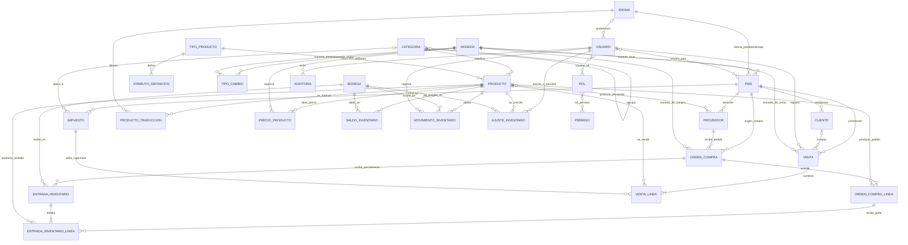

# Modelo conceptual — PixelVault: sistema de inventario

**Nombre del producto:** PixelVault — nombre comercial de la plataforma; se muestra en la interfaz y la documentación.

**Etapa:** E1 — Análisis y modelo conceptual
**Base:** `REQUIREMENTS.md` v0.7, apartado 7.3, y `GUIDE.md` v1.0
**Estado:** E1 aprobado; no define columnas SQL ni contratos de API.

## 1. Alcance y decisiones aplicadas

Este modelo cubre el corte vertical de la primera entrega: usuarios y permisos,
catálogo traducible, proveedores y clientes básicos, inventario y ajustes
aprobados, ventas de mostrador, configuración de Colombia y Estados Unidos,
monedas COP y USD, impuestos, tipos de cambio manuales, parámetros y reportes
CSV de existencias y movimientos.

Quedan fuera del modelo de esta entrega las devoluciones, traslados, serialización
individual, garantías, recompra, preventas, envíos, aduanas, importaciones,
facturación electrónica real, MFA y comercio electrónico para clientes. Estas
funciones permanecen documentadas como fase 2.

Decisiones aclaradas durante E1:

1. Una venta puede registrarse sin cliente asociado. Si se capturan datos del
   comprador, se relaciona el cliente correspondiente; no se crean datos
   personales innecesarios para la venta anónima.
2. Se incluye una `orden_compra` básica para agrupar una o más recepciones
   parciales y contrastar lo pedido con lo recibido. No se modelan en esta etapa
   sus funciones de importación, transporte o aduana.

## 2. Entidades del dominio

Las entidades están agrupadas por responsabilidad. Las asociaciones indicadas
como muchos-a-muchos se materializarán mediante entidades asociativas en E2.

| Grupo | Entidades | Responsabilidad conceptual |
|---|---|---|
| Parametrización | `parametro` | Valor configurable, tipo, límites, valor por defecto, ámbito de negocio o país y vigencia. |
| Países, monedas e idioma | `pais`, `moneda`, `idioma`, `tipo_cambio`, `impuesto` | Configuración de operación por país; catálogo ISO de monedas e idiomas; tasa manual fechada; tarifas tributarias por país, categoría y vigencia. |
| Seguridad | `usuario`, `rol`, `usuario_rol`, `permiso`, `rol_permiso`, `usuario_pais` | Identidad de acceso, roles y permisos acumulados; países autorizados para el usuario cuando aplique. `usuario_pais` es una asociación conceptual necesaria para el límite de acceso por país. |
| Catálogo | `categoria`, `tipo_producto`, `atributo_definicion`, `producto`, `producto_traduccion`, `precio_producto` | Clasificación jerárquica, definición configurable de atributos, identidad estable del producto, traducciones y precios por moneda. |
| Terceros | `proveedor`, `producto_proveedor`, `cliente` | Datos de proveedores oficiales y clientes. El cliente conserva el registro de consentimiento/base legal aplicable. `producto_proveedor` registra la relación oficial muchos-a-muchos producto/proveedor. |
| Compras y recepción | `orden_compra`, `orden_compra_linea`, `entrada_inventario`, `entrada_inventario_linea` | Pedido básico a un proveedor y sus cantidades/costos; una orden puede recibirse en varias entradas parciales con documento y fecha propios. |
| Inventario | `bodega`, `saldo_inventario`, `movimiento_inventario`, `ajuste_inventario` | Ubicaciones internas, saldo por producto y bodega, libro inmutable de movimientos y solicitud/aprobación/aplicación de conteos. |
| Ventas | `venta`, `venta_linea` | Venta con país, estado, importes congelados en moneda y tipo de cambio de la operación; cada línea identifica el producto, cantidad, precio e impuesto calculado. |
| Transversal | `auditoria`, `migracion_historial` | Registro inmutable de operaciones críticas y control de migraciones y sus checksums. |

### Relaciones principales

El siguiente diagrama expresa relaciones conceptuales y no fija aún nombres de
claves foráneas ni nulabilidad técnica, salvo la relación opcional entre venta y
cliente acordada para E1.



Las referencias de país en cliente, proveedor, venta y compra identifican su
contexto geográfico; no representan sucursales. La operación inicial tiene una
sola tienda física y sus existencias se dividen en bodegas internas. Los
atributos logísticos de producto, incluido su país de origen, no forman parte del
alcance de la primera entrega.

## 3. Reglas de integridad y consistencia

1. `producto.codigo_interno` identifica un producto de forma única. Un producto
   se puede desactivar, pero no eliminar físicamente si puede tener historial.
2. `producto.atributos` se valida contra las definiciones vigentes de su
   `tipo_producto`. El contenido traducido se guarda por idioma; cuando falte
   traducción se usa el idioma predeterminado.
3. El saldo se identifica por combinación producto/bodega, es entero y nunca
   negativo. El saldo disponible corresponde a existencias físicas en esta
   entrega; las reservas pertenecen a fase 2.
4. Toda entrada, salida, venta confirmada o ajuste aplicado crea un
   `movimiento_inventario` y actualiza el saldo de forma atómica, dentro de una
   misma transacción y con protección frente a actualizaciones concurrentes.
   Si falla cualquiera de los cambios, no se persiste ninguno.
5. Una orden de compra tiene líneas de productos y cantidades pedidas. Cada
   recepción parcial referencia la orden y registra sus propias líneas; la suma
   recibida no puede superar lo pedido. Una recepción válida incrementa el
   saldo y registra proveedor, documento, costo, moneda y tipo de cambio
   aplicados.
6. Una salida exige saldo suficiente. Los motivos contemplados en esta entrega
   son venta confirmada, pérdida, daño, robo y defecto. Traslados y devoluciones
   no se registran en esta fase.
7. Todo ajuste conserva cantidad registrada, cantidad contada, diferencia,
   motivo, solicitante, aprobador y marcas de tiempo. Ningún ajuste afecta el
   saldo hasta aprobación explícita del administrador. El encargado de
   inventario solicita los ajustes operativos; el experto técnico solicita los
   ajustes de naturaleza técnica. El requisito no define un segundo aprobador
   para ajustes operativos.
8. Una venta puede carecer de cliente asociado; si se asocia un cliente, debe
   conservar el país declarado y respetar los datos mínimos de cliente
   infrecuente. Se mantienen los datos de contacto solo de acuerdo con la
   clasificación y retención configurables.
9. Una venta pendiente de pago no modifica existencias. Solo al confirmarse se
   valida inventario e impuesto, se crea la salida y se conserva el desglose de
   moneda, tasa aplicada e impuestos de ese instante. No se permite anular una
   venta confirmada; las devoluciones están fuera de esta entrega.
10. No se confirma una venta si el país no está habilitado o carece de tarifa de
    impuesto vigente para la categoría correspondiente. Cada venta registra
    país y moneda; cada compra registra proveedor, país, moneda y tipo de cambio
    aplicado.
11. La tasa de cambio es una relación fechada entre monedas, capturada
    manualmente en la primera entrega. Las transacciones existentes conservan
    su tasa e importes base aunque cambie la tasa actual.
12. Los parámetros tienen ámbito `NEGOCIO` o `PAIS`, valor, límites y vigencia.
    Si coinciden una regla de negocio y otra de país, se aplica la específica
    del país mientras esté vigente. Los cambios registran autor, fecha, valor
    anterior y nuevo.
13. Los movimientos y registros de auditoría son inmutables: no se actualizan
    ni eliminan mediante operaciones ordinarias. Los movimientos tienen una
    retención predeterminada de hasta 8 años; la auditoría, de al menos 10 años
    o el mínimo legal superior. La retención es configurable y la depuración de
    movimientos no borra su evidencia de auditoría.
14. Los usuarios acumulan los permisos de sus roles. Si tienen países
    restringidos, no pueden consultar ni modificar información de otros países.
    La auditoría es de solo lectura y limitada al área autorizada.
15. Importes monetarios se representan con precisión decimal exacta; se
    normalizan los códigos ISO de país/moneda e idioma y las fechas se conservan
    en UTC.

## 4. Estados del corte vertical

### Venta

```text
PENDIENTE_DE_PAGO ──confirmar pago──> CONFIRMADA
       │
       └──anular (solo mientras siga pendiente)──> ANULADA
```

Al pasar a `CONFIRMADA`, el sistema descuenta las existencias y registra el
movimiento correspondiente. Los estados `DEVUELTA_PARCIAL` y `DEVUELTA_TOTAL`
se reservan para la fase de devoluciones y no se implementan en esta entrega.

### Pago

`SIN_PAGO → PAGADO`. El crédito y los pagos parciales quedan fuera del alcance.

### Orden de compra y recepción

```text
BORRADOR → ENVIADA_AL_PROVEEDOR → RECIBIDA_PARCIAL → RECIBIDA_COMPLETA
BORRADOR / ENVIADA_AL_PROVEEDOR → CANCELADA
```

La cancelación solo procede desde `BORRADOR` o `ENVIADA_AL_PROVEEDOR`, antes de
recibir cualquier cantidad. Una orden puede estar recibida parcialmente mientras
existan cantidades pendientes; una orden parcialmente recibida no se cancela.
Los estados `EN_TRANSITO` y `EN_ADUANA` se reservan para importaciones de fase 2.

### Ajuste

```text
PENDIENTE_DE_APROBACION → APROBADO → APLICADO
```

Solo `APLICADO` cambia el saldo. La especificación no define un flujo de rechazo
ni sus efectos; por ello no se agrega un estado de rechazo al modelo de E1.

## 5. Casos de uso por rol

| Caso | Caso de uso | Roles habilitados en el corte vertical |
|---|---|---|
| CU-01 | Iniciar sesión, administrar usuarios, roles, permisos y parámetros de acceso. | Administrador (gestiona); todos los usuarios del sistema (inician sesión). |
| CU-02 | Consultar y mantener países, monedas, idiomas, tipos de cambio, impuestos y parámetros vigentes. | Administrador. |
| CU-03 | Consultar catálogo e inventario. | Todos los roles del sistema. |
| CU-04 | Crear, editar, desactivar y traducir productos; gestionar categorías y proveedores asociados. | Administrador, Encargado de inventario. |
| CU-05 | Registrar y consultar proveedores oficiales; vincular proveedor con productos y órdenes de compra. | Administrador, Encargado de inventario; Gerente/propietario solo lectura de proveedores. |
| CU-06 | Registrar cliente frecuente o infrecuente y consultar sus datos autorizados. | Administrador, Vendedor/cajero. |
| CU-07 | Crear orden de compra básica, registrar entradas totales o parciales y consultar existencias. | Administrador, Encargado de inventario. |
| CU-08 | Registrar salida por pérdida, daño, robo o defecto. | Administrador, Encargado de inventario; las salidas por venta se realizan en CU-11. |
| CU-09 | Solicitar ajuste por conteo físico y consultar su estado. | Encargado de inventario (operativo), Experto técnico (técnico). |
| CU-10 | Aprobar y aplicar ajuste autorizado. | Administrador. |
| CU-11 | Registrar venta, pago, impuesto e importe en moneda seleccionada; emitir recibo simulado. | Administrador, Vendedor/cajero. |
| CU-12 | Anular venta todavía pendiente de pago. | Administrador, Vendedor/cajero. |
| CU-13 | Consultar historial de movimientos y auditoría del área autorizada. | Administrador (todo, solo lectura); Encargado de inventario (inventario); Experto técnico (área técnica). |
| CU-14 | Consultar reportes permitidos y exportar existencias y movimientos a CSV. | Administrador, Gerente/propietario; Encargado de inventario, solo reportes de inventario. |

## 6. Matriz resumida de permisos

`G` = gestionar; `C` = consultar; `S` = solicitar; `A` = aprobar/aplicar;
`—` = sin acceso en el corte vertical.

| Operación | Administrador | Encargado de inventario | Experto técnico | Vendedor/cajero | Gerente/propietario |
|---|---:|---:|---:|---:|---:|
| Usuarios, roles, países, monedas, impuestos, tasas y parámetros | G | — | — | — | — |
| Crear, modificar y desactivar productos | G | G | — | — | — |
| Consultar catálogo e inventario | C | C | C | C | C |
| Proveedores | G | G | — | — | C |
| Órdenes de compra y entradas de inventario | G | G | — | — | — |
| Clientes | G | — | — | G | — |
| Registrar y anular ventas pendientes | G | — | — | G | — |
| Solicitar ajuste operativo | — | S | — | — | — |
| Solicitar ajuste técnico | — | — | S | — | — |
| Aprobar y aplicar ajuste | A | — | — | — | — |
| Reportes | G/C | C (inventario) | — | — | C |
| Auditoría | C (solo lectura) | C (inventario) | C (solo técnico) | — | — |

La suma de roles es acumulativa. La limitación por país se aplica de forma
adicional a los permisos, no los amplía. Esta matriz respeta el Anexo D de la
guía y omite operaciones explícitamente fuera de la primera entrega.

## 7. Trazabilidad del corte vertical

Cada fila enlaza el requisito con las entidades conceptuales y los casos de uso
que materializan su comportamiento. Los requisitos no funcionales se vinculan
con las entidades y flujos a los que aplican.

| Requisito | Entidades relacionadas | Casos de uso | Cobertura en esta entrega |
|---|---|---|---|
| RF-001 — Catálogo de productos | `producto`, `categoria`, `tipo_producto`, `atributo_definicion`, `producto_traduccion`, `precio_producto`, `moneda` | CU-03, CU-04 | CRUD, código único, atributos configurables y catálogo traducible. |
| RF-002 — Consulta de inventario | `producto`, `bodega`, `saldo_inventario` | CU-03 | Consulta de saldo por producto y bodega. |
| RF-003 — Entradas de inventario | `proveedor`, `producto_proveedor`, `orden_compra`, `orden_compra_linea`, `entrada_inventario`, `entrada_inventario_linea`, `movimiento_inventario`, `saldo_inventario`, `moneda`, `tipo_cambio` | CU-05, CU-07 | Recepción documentada, vinculada al proveedor y orden, incluida recepción parcial. |
| RF-004 — Salidas y movimientos | `movimiento_inventario`, `saldo_inventario`, `venta`, `venta_linea`, `usuario`, `auditoria` | CU-08, CU-11, CU-13 | Salidas por venta confirmada, pérdida, daño, robo o defecto; sin traslados ni devoluciones. |
| RF-005 — Conteo y ajuste | `ajuste_inventario`, `movimiento_inventario`, `saldo_inventario`, `usuario`, `auditoria` | CU-09, CU-10 | Solicitud, aprobación administrativa y aplicación trazable. |
| RF-006 — Usuarios y permisos | `usuario`, `rol`, `usuario_rol`, `permiso`, `rol_permiso`, `usuario_pais`, `parametro`, `auditoria` | CU-01, CU-13 | Roles, autorización, bloqueo y vencimiento parametrizados; sin MFA. |
| RF-007 — Trazabilidad de movimientos | `movimiento_inventario`, `auditoria`, `usuario` | CU-13 | Consulta filtrable y retenciones diferenciadas; auditoría inmutable. |
| RF-008 — Reportes | `saldo_inventario`, `movimiento_inventario`, `venta`, `entrada_inventario`, `orden_compra`, `moneda`, `tipo_cambio`, `usuario` | CU-14 | Reportes del corte: existencias y movimientos exportables a CSV. |
| RF-009 — Proveedores | `proveedor`, `producto_proveedor`, `orden_compra`, `pais`, `moneda` | CU-05, CU-07 | Registro básico de proveedores oficiales; sin acceso propio ni integración externa. |
| RF-010 — Ventas | `venta`, `venta_linea`, `cliente`, `producto`, `moneda`, `tipo_cambio`, `impuesto`, `movimiento_inventario`, `saldo_inventario`, `auditoria` | CU-06, CU-11, CU-12 | Venta de mostrador, impuesto, moneda, pago y recibo simulado; sin crédito ni promociones. |
| RF-015 — Clientes | `cliente`, `pais`, `venta`, `parametro`, `auditoria` | CU-06, CU-11 | Registro básico, clasificación y retención configurables; consentimiento registrado. |
| RF-020 — Parametrización general | `parametro`, `pais`, `moneda`, `idioma`, `tipo_producto`, `atributo_definicion`, `categoria`, `rol`, `permiso`, `impuesto`, `auditoria` | CU-01, CU-02, CU-04 | Parámetros, catálogos y vigencias administrables sin cambiar código. |
| RF-021 — Configuración por país | `pais`, `moneda`, `idioma`, `impuesto`, `cliente`, `proveedor`, `venta`, `orden_compra`, `usuario_pais` | CU-02, CU-06, CU-07, CU-11 | Países habilitados CO y US; ventas bloqueadas con configuración tributaria incompleta. |
| RF-022 — Multimoneda y tipos de cambio | `moneda`, `tipo_cambio`, `precio_producto`, `venta`, `orden_compra`, `entrada_inventario`, `parametro` | CU-02, CU-04, CU-07, CU-11, CU-14 | COP y USD, tasas manuales y snapshot del tipo de cambio en transacciones. |
| RF-023 — Idiomas y localización | `idioma`, `usuario`, `producto_traduccion`, `pais` | CU-01, CU-04 | Interfaz es/en, preferencia de usuario y traducciones del catálogo con fallback. |
| RNF-003 — Seguridad | `usuario`, `rol`, `permiso`, `usuario_rol`, `usuario_pais`, `parametro`, `auditoria` | CU-01, CU-13 | Autorización por rol/país, contraseña protegida, bloqueo e inactividad configurables. |
| RNF-004 — Integridad y consistencia | `saldo_inventario`, `movimiento_inventario`, `entrada_inventario`, `venta`, `ajuste_inventario` | CU-07 a CU-12 | Saldos no negativos y operaciones atómicas. |
| RNF-006 — Mantenibilidad | Todas las entidades configurables, especialmente `parametro`, `pais`, `moneda`, `idioma`, `impuesto` y `atributo_definicion` | CU-01, CU-02, CU-04 | Valores comerciales y catálogos fuera de lógica fija. |
| RNF-010 — Auditabilidad | `auditoria`, `movimiento_inventario`, `usuario` | CU-07 a CU-13 | Registro de operaciones críticas, actor, instante y contexto; registros inmutables. |
| RNF-014 — Protección de datos personales | `cliente`, `pais`, `venta`, `auditoria`, `parametro` | CU-06, CU-11 | Consentimiento/base legal registrada, minimización y retención por país. |
| RNF-015 — Internacionalización | `pais`, `moneda`, `idioma`, `tipo_cambio`, `impuesto`, `producto_traduccion`, entidades transaccionales | CU-02, CU-04, CU-07, CU-11, CU-14 | Códigos normalizados, fecha UTC, localización es/en y decimales exactos. |
| RNF-016 — Parametrización | `parametro`, `auditoria` | CU-01, CU-02 | Ámbito, rango, vigencia, aplicación y auditoría del cambio. |
| RNF-017 — Operación en varios países | `pais`, `cliente`, `proveedor`, `venta`, `orden_compra`, `usuario_pais` | CU-02, CU-05 a CU-07, CU-11, CU-14 | País en las transacciones y filtro de acceso por país. |

Los requisitos RNF-003, RNF-004, RNF-006, RNF-010, RNF-014, RNF-015, RNF-016 y
RNF-017 se incluyen por formar parte de la primera entrega indicada en el
apartado 7.3 de los requisitos y en la guía.

## 8. Elementos para concretar en E2

- Traducir las entidades y relaciones a módulos JSON y decidir los campos
  concretos, claves, restricciones e índices conforme al formato del Anexo A.
- Definir el mecanismo del consentimiento del cliente y el mínimo de datos por
  país, sin almacenar datos personales que no requiera el caso de uso.
- Definir los campos requeridos para el recibo simulado y el desglose de
  impuestos de la venta.
- Precisar cómo se identifica una orden de compra y cómo se valida el acumulado
  de recepciones parciales frente a las cantidades pedidas.
- Formalizar la política de estados y retención como parámetros versionados,
  respetando valores y mínimos legales descritos en los requisitos.
